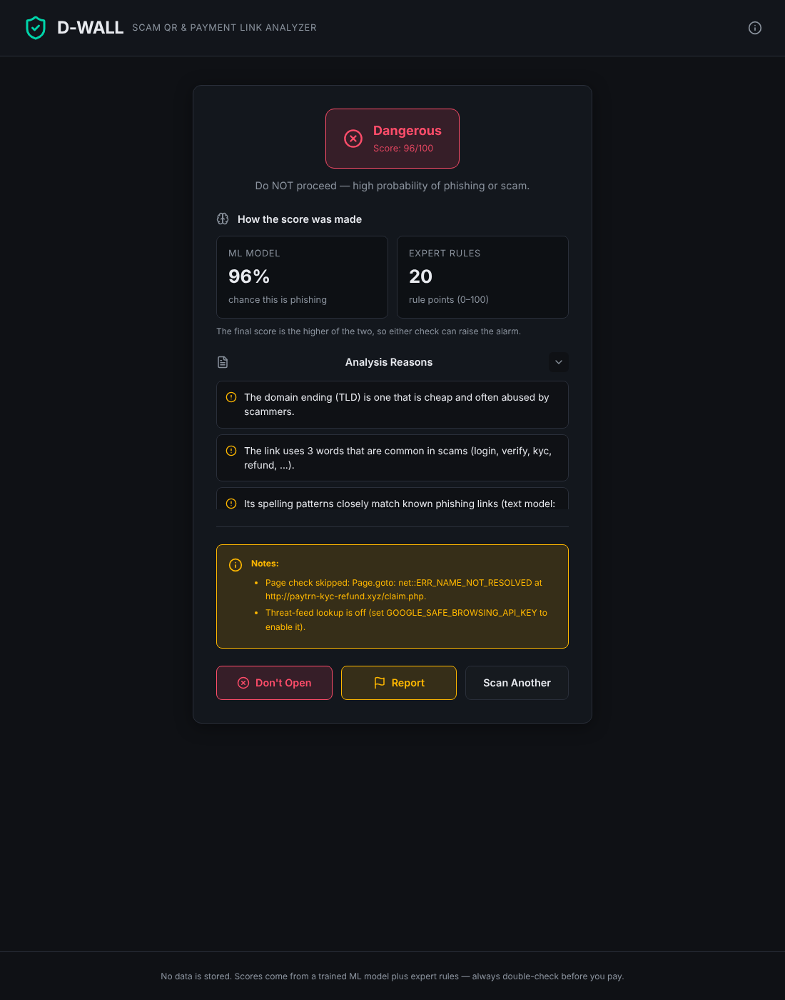
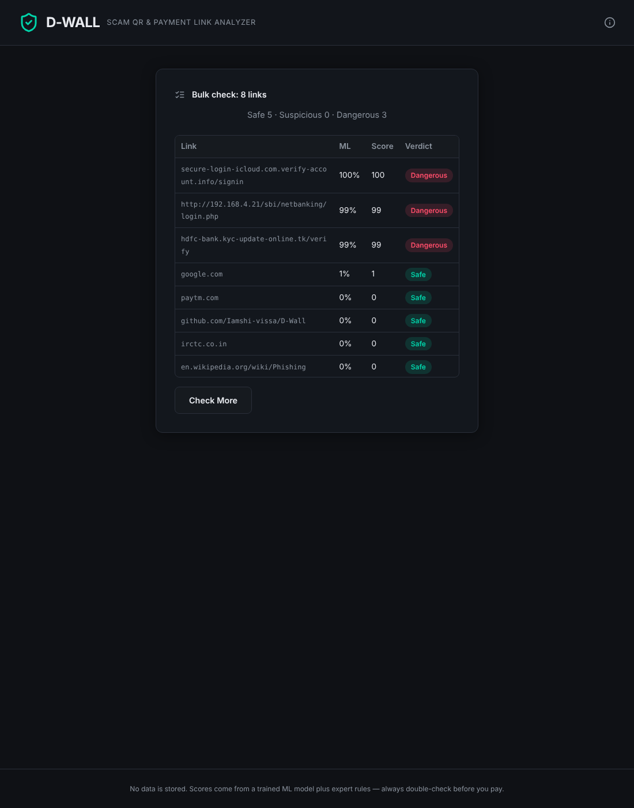
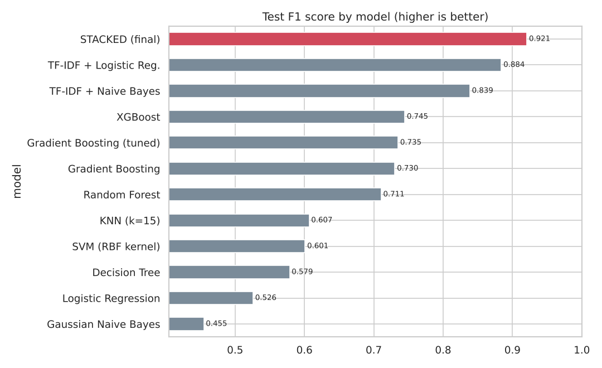
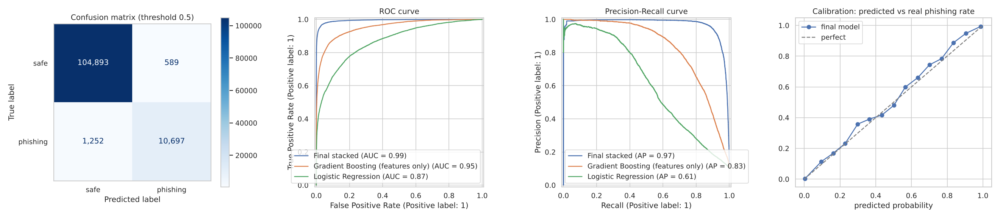
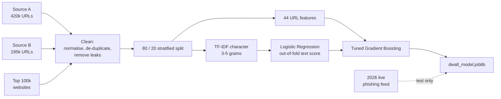
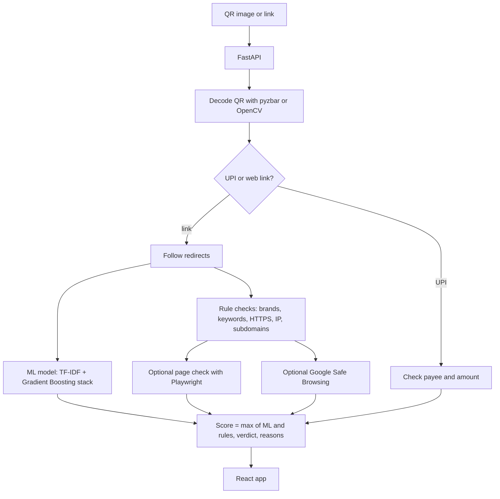

# D-WALL

Check a QR code or payment link for signs of a scam before you pay — powered by a trained machine-learning model.

## ABOUT

Payment scams in India often arrive as a QR code or a *UPI* link: "scan to get your refund",
"claim your cashback". D-WALL takes the QR image or the link, works out where it really leads, and
gives it a score from 0 to 100 with a plain list of reasons, so you can decide before you pay.

Version 2 adds a **phishing-URL model trained on ~590,000 links** and validated five different ways. The model and the
rule checks each give a score, and D-WALL shows the higher one, so either check can raise the alarm.

<p align="center">
  
  
</p>

## CONTENTS

[Results](#results) · [Features](#features) · [How the model was built](#how-the-model-was-built) ·
[How it works](#how-it-works) · [Architecture](#architecture) · [Tech stack](#tech-stack) ·
[Getting started](#getting-started) · [Try it](#try-it) · [API](#api) · [Project structure](#project-structure) ·
[Status and limitations](#status-and-limitations)

## RESULTS

Final model: **stacked ensemble** — TF-IDF character n-grams + Logistic Regression, feeding a tuned
Histogram Gradient Boosting model with 44 hand-made URL features.

| Validation | Result |
|---|---|
| Held-out test set (117,431 URLs) | **F1 0.921 · ROC-AUC 0.994 · precision 0.948 · recall 0.895 · accuracy 98.4%** |
| 5-fold cross-validation (final model) | F1 **0.911 ± 0.005**, ROC-AUC 0.992 ± 0.001 |
| Test per source | Source A F1 0.938 · Source B F1 0.913 |
| Cross-dataset experiment | trained on A only → F1 drops from 0.933 to 0.769 on B (dataset shift); training on A + B brings B back to 0.913 |
| False alarms on unseen popular websites (19,799 home pages) | **0.97%** flagged Suspicious, 0.17% flagged Dangerous |
| 30,000 unseen phishing links active in 2026 | 68% flagged Suspicious or Dangerous |
| Speed | ~8,300 URLs/second on one CPU core, ~4.5 ms per link |

It beat all 11 other models tested (full table in the notebook):





## FEATURES

- Upload a QR code image or paste a link or *UPI* string
- **ML phishing probability** for every web link, with plain-English reasons ("brand name in the wrong place",
  "free hosting service", "random-looking domain", ...)
- **Bulk check**: paste up to 1,000 links and get them all scored in about a second
- Follows redirects (up to 5 hops) and shows the full chain, so short links can't hide where they go
- Checks UPI payment requests: the payee ID format and the amount asked for
- Spots domains that look like payment brands (for example `paytrn` instead of `paytm`)
- Flags warning words like "refund", "KYC", "reward" or "suspended", plain HTTP, raw IP addresses
  and long chains of subdomains
- Optionally opens the page in a *headless browser* to look for password, PIN or OTP forms
- Optional Google Safe Browsing lookup (set an API key)
- Result: **Safe** (0–30), **Suspicious** (31–70) or **Dangerous** (71–100)

## HOW THE MODEL WAS BUILT

Everything is in [`ml/D-WALL_Model_Training.ipynb`](ml/D-WALL_Model_Training.ipynb), which is saved with all its outputs.



| Step | What was done | Concept |
|---|---|---|
| Data | 4 sources: two research URL datasets (A, B), the 100k most popular websites (T), and a 2026 live phishing feed kept only for testing | Data collection |
| Cleaning | Remove the scheme and `www.` (it leaked the label), de-duplicate, drop URLs in both A and B, remove any test URL seen in training | Preprocessing, leakage control |
| EDA | Class balance, URL-length distributions, phishing share per TLD, correlation heatmap | EDA |
| Features | 44 hand-made features (`backend/ml/features.py`) + TF-IDF on character 3–5-grams; `StandardScaler` for distance-based models | Feature engineering, scaling |
| Classic models | Logistic Regression, KNN, Decision Tree, Gaussian NB, RBF SVM — stratified 5-fold CV | Classic models, cross-validation |
| Ensembles | Random Forest, Gradient Boosting, XGBoost; `GridSearchCV` over 12 boosting settings; tuned `C` for the text model | Bagging, boosting, tuning |
| Final model | Out-of-fold text score (`cross_val_predict`) stacked into tuned gradient boosting | Stacking |
| PCA | Explained variance (29 of 44 components keep 95%), 2-D projection, PCA + Logistic Regression | Dimensionality reduction |
| K-Means | Groups phishing URLs into "families" (hacked sites with deep paths, IP links, long-query links, plain domains); k chosen with elbow + silhouette | Clustering |
| Evaluation | Confusion matrix, ROC, precision-recall, threshold table for D-WALL's 31/71 cut-offs, calibration curve, permutation importance | Metrics |

**A problem found and fixed during validation:** the first version, trained on A + B only, scored `google.com` and
`paytm.com` as phishing. In source A almost every safe URL has a path, while many phishing entries are bare
domains, so the model had learned "no path = scam". Adding popular home pages (source T) fixed it. Those sites now
score under 1%, and the false-alarm test above checks this on sites the model never saw.

## HOW IT WORKS

1. The QR image is decoded with OpenCV and pyzbar to get the text inside it.
2. If it's a *UPI* string (`upi://pay?...`), the payee and amount are checked with rules.
3. If it's a web link, short links are followed to the final address.
4. The **ML model** scores the final address (probability × 100).
5. The **rules** score it too: look-alike brands, keywords, HTTP, IP address, subdomains, redirect hops, and the
   optional page and threat-feed checks.
6. Final score = the higher of the two. The verdict and all reasons are returned.

## ARCHITECTURE



## TECH STACK

<p align="center">
  
  
  
  
  
  
  
</p>

| Layer | Technology |
|---|---|
| ML model | scikit-learn (TF-IDF, Logistic Regression, HistGradientBoosting), joblib |
| Training | Jupyter, pandas, XGBoost, matplotlib, seaborn |
| API | Python, FastAPI |
| QR decoding | OpenCV, pyzbar |
| Link checks | requests; Playwright (optional); Google Safe Browsing (optional) |
| Web app | React, Vite |

## GETTING STARTED

You need **Python 3.11+** (required by scikit-learn 1.9) and Node.js 20+. QR decoding with pyzbar also needs the zbar
library (`sudo apt install libzbar0` on Debian/Ubuntu, `brew install zbar` on macOS). Without it, D-WALL falls back to
OpenCV.

Backend:

```bash
git clone https://github.com/Iamshi-vissa/D-Wall.git
cd D-Wall/backend
python -m venv .venv
source .venv/bin/activate            # Windows: .venv\Scripts\activate
pip install -r requirements.txt
uvicorn main:app --reload --port 8000
```

The trained model (`backend/ml/dwall_model.joblib`, 2.9 MB) is included, so you don't need to retrain.
Open <http://localhost:8000/model/info> to see its metrics.

Optional extras:

```bash
pip install playwright && playwright install chromium        # page check
export GOOGLE_SAFE_BROWSING_API_KEY=your-key                 # threat-feed lookup
```

Frontend, in a second terminal:

```bash
cd D-Wall/frontend
npm install
npm run dev
```

Open the address Vite prints, usually <http://localhost:5173>.

### RETRAIN THE MODEL

```bash
cd D-Wall/ml
pip install -r requirements-ml.txt
jupyter notebook D-WALL_Model_Training.ipynb     # Run All: downloads data (~110 MB) and takes about 10 minutes
```

### RUN THE TESTS

```bash
cd D-Wall/backend
pip install -r requirements-dev.txt
pytest
```

## TRY IT

Paste these into the app (or the Bulk Check tab) to see the model at work:

| Link | What D-WALL says |
|---|---|
| `google.com`, `paytm.com`, `irctc.co.in` | Safe (ML under 1%) |
| `http://paytrn-kyc-refund.xyz/claim.php` | Dangerous: risky TLD, scam words, spelling that matches known phishing |
| `phonepe-cashback-reward.000webhostapp.com/upi/claim.php` | Dangerous: free hosting, brand name in the wrong place |
| `http://192.168.4.21/sbi/netbanking/login.php` | Dangerous: raw IP address, banking login path |
| `upi://pay?pa=refund.kyc@okaxis&pn=KYC%20Refund&am=25000` | Suspicious: high amount, "refund" in the payee |

## API

| Endpoint | What it does |
|---|---|
| `GET /health` | Check the API is running and the model is loaded |
| `GET /model/info` | The model's validation metrics and tuned parameters |
| `POST /analyze/link` | Body `{"input": "<link or UPI string>"}` — full check |
| `POST /analyze/batch` | Body `{"urls": ["...", "..."]}` — up to 1,000 links, ML + offline rules, no network calls |
| `POST /analyze/qr` | Upload a QR image as `file` (max 5 MB) |

Inputs are validated: empty input and links over 2,048 characters are rejected, and batch requests are limited
to 1,000 URLs.

Example:

```bash
curl -X POST http://localhost:8000/analyze/link \
     -H "Content-Type: application/json" \
     -d '{"input": "phonepe-cashback-reward.000webhostapp.com/upi/claim.php"}'
```

```json
{
  "score": 99,
  "verdict": "Dangerous",
  "ml": {
    "available": true,
    "probability": 0.993,
    "reasons": [
      "The site is on a free hosting service, which scammers use to set up pages quickly.",
      "A brand name appears in the address, but the site is not that brand's real domain."
    ]
  },
  "rule_score": 30,
  "final_url": "https://phonepe-cashback-reward.000webhostapp.com/upi/claim.php"
}
```

(Shortened. The full response also has every reason, the redirect chain, the page check and notes.)

## PROJECT STRUCTURE

```
backend/main.py                 the API, rule checks and scoring
backend/ml/features.py          44 URL features (shared by training and the API)
backend/ml/predictor.py         loads the model, scores and explains URLs
backend/ml/dwall_model.joblib   the trained model
backend/tests/                  pytest tests for features and API
ml/D-WALL_Model_Training.ipynb  full training and validation notebook (with outputs)
ml/figures/                     charts from the notebook
ml/metrics.json                 final metrics
frontend/src/                   the web app that runs today
frontend/client/                a newer interface, not wired up yet (see Status)
```

## STATUS AND LIMITATIONS

- **Phishing on trusted platforms is hard to catch from the URL alone.** Pages hosted on site builders or cloud
  services (`*.weebly.com`, `*.workers.dev`, ...) look like normal links. About a third of the 2026 live phishing
  links are missed, many of them of this kind. The page check and the threat-feed lookup are there to cover this gap.
- **Training data age.** Sources A and B are public research datasets from a few years ago. Retraining regularly with
  fresh phishing feeds would keep the model current.
- **Domain age** (WHOIS) is not checked. The old fake domain-age stub was removed from scoring.
- **Two frontends.** `npm run dev` serves the interface in `frontend/src`, which shows the ML score and has the bulk
  check. The newer one in `frontend/client` still depends on packages from the tool it was made with, which aren't
  in the lockfile, so it doesn't build yet.

## LICENSE

MIT. See [LICENSE](LICENSE).
