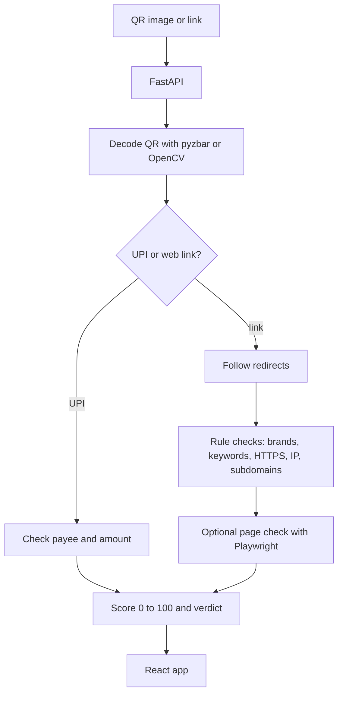

# D-WALL

Check a QR code or payment link for signs of a scam before you pay.

## ABOUT

Payment scams in India often arrive as a QR code or a *UPI* link: "scan to get your refund",
"claim your cashback". D-WALL takes the QR image or the link, works out where it really leads, and
gives it a score from 0 to 100 with a plain list of reasons, so you can decide before you pay.

It's a *prototype*. Some checks are real and some are still *placeholders* (see Status).

## FEATURES

- Upload a QR code image or paste a link or *UPI* string
- Follows redirects (up to 5 hops) and shows the full chain, so short links can't hide where they go
- Checks UPI payment requests: the payee ID format and the amount asked for
- Spots domains that look like payment brands (for example `paytrn` instead of `paytm`)
- Flags warning words like "refund", "KYC", "reward" or "suspended", plain HTTP, raw IP addresses
  and long chains of subdomains
- Optionally opens the page in a *headless browser* to look for password or card forms
- Result: **Safe** (0–30), **Suspicious** (31–70) or **Dangerous** (71–100), with the reasons

## HOW IT WORKS

1. The QR image is decoded with OpenCV and pyzbar to get the text inside it.
2. If it's a *UPI* string (`upi://pay?...`), the payee and amount are checked.
3. If it's a web link, the redirects are followed to the final address, and that address is checked
   against the rules above.
4. Each rule that matches adds points and a reason. The total becomes the *verdict*.

## ARCHITECTURE



Each rule that matches adds points and a reason. The total decides the *verdict*.

## TECH STACK

<p align="center">
  
  
  
  
  
  
</p>

| Layer | Technology |
|---|---|
| API | Python, FastAPI |
| QR decoding | OpenCV, pyzbar |
| Link checks | requests; Playwright (optional) |
| Web app | React, Vite |

## GETTING STARTED

You need Python 3.10+ and Node.js 20+. QR decoding with pyzbar also needs the zbar library
(`sudo apt install libzbar0` on Debian/Ubuntu, `brew install zbar` on macOS). Without it, D-WALL
falls back to OpenCV.

Backend:

```bash
git clone https://github.com/Iamshi-vissa/D-Wall.git
cd D-Wall/backend
python -m venv .venv
source .venv/bin/activate            # Windows: .venv\Scripts\activate
pip install -r requirements.txt
uvicorn main:app --reload --port 8000
```

Optional, for the page check:

```bash
pip install playwright
playwright install chromium
```

Frontend, in a second terminal:

```bash
cd D-Wall/frontend
npm install
npm run dev
```

Open the address Vite prints, usually <http://localhost:5173>.

## API

| Endpoint | What it does |
|---|---|
| `GET /health` | Check the API is running |
| `POST /analyze/link` | Body `{"input": "<link or UPI string>"}` |
| `POST /analyze/qr` | Upload a QR image as `file` |

## PROJECT STRUCTURE

```
backend/main.py     the API and every check
frontend/src/       the web app that runs today
frontend/client/    a newer interface, not wired up yet (see Status)
```

## STATUS

*Prototype*. Things that need work:

- **Domain age is fake.** It's a made-up number based on the domain's letters, and it still adds
  points to the score. It should either use a real WHOIS lookup or be switched off.
- **Threat lists aren't checked.** The lookup always says "not listed". It should call a service
  like Google Safe Browsing, VirusTotal or PhishTank.
- **Two frontends.** `npm run dev` serves the original interface in `frontend/src`. The newer one in
  `frontend/client` is more complete, but it doesn't build yet: it still depends on packages from the
  tool it was made with, which aren't in the lockfile.
- The brand list only covers Indian payment apps (Paytm, PhonePe, Google Pay, BHIM and others).
- There are no automated tests yet.

## LICENSE

MIT. See [LICENSE](LICENSE).
